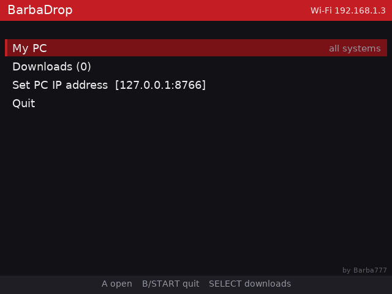
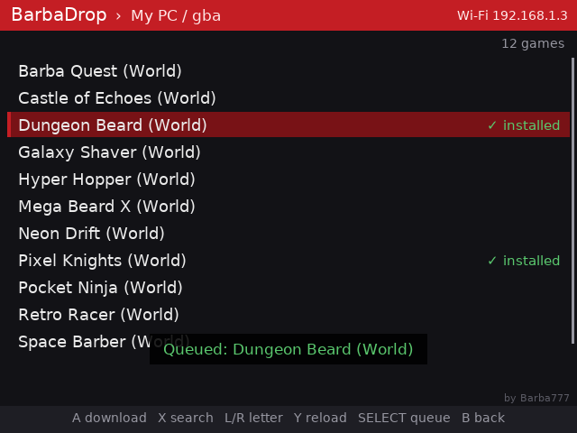
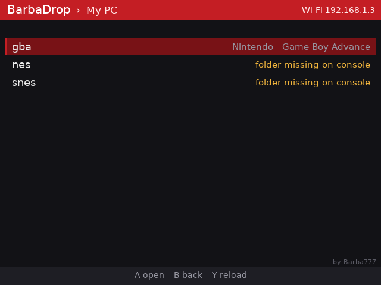
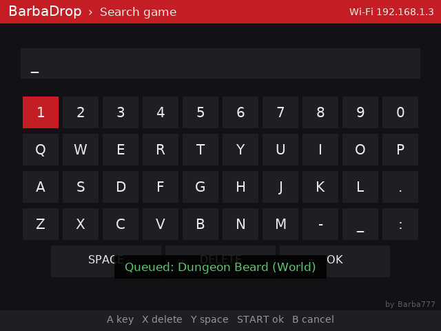
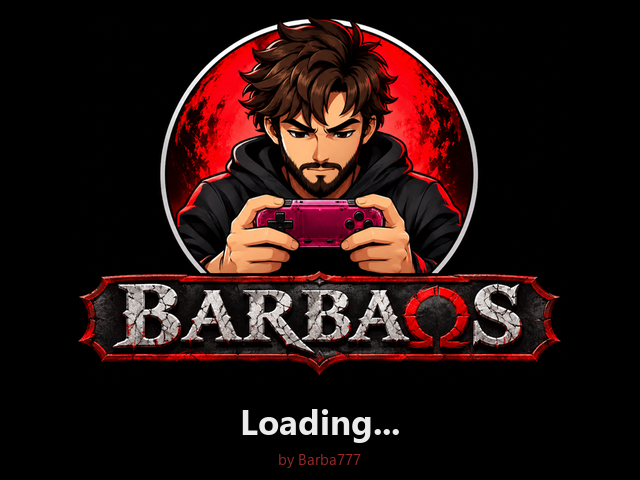

# [BarbaOS](https://julianoalvescode.github.io/barbaos/)


## A customized dArkOS4Clone build for the R36S, by Barba777.

BarbaOS is built **on top of** [ArkOS4Clone](https://github.com/lcdyk0517/arkos4clone) / dArkOS:
BarbaOS look and feel, its own apps in the **Options** menu, the EpicAeolus theme, and an audio fix for the V20 board.

For the base system:

- ArkOS4Clone (R36S and clones): https://github.com/lcdyk0517/arkos4clone
- dArkOS made for the R36S and clones: https://github.com/southoz/dArkOSRE-R36
- More about dArkOS: https://github.com/christianhaitian/dArkOS/wiki

# Download

## R36S / R35S / R36S clones (full SD card image)

Download BarbaOS | [Releases](https://github.com/julianoalvescode/barbaos/releases/latest) | BarbaOS 1.0 (based on dArkOS4Clone 20261008)

Download **all** parts `BarbaOS-1.0-R36S.img.xz.7z.001`, `.002`, … into the same folder.

> [!NOTE]
> The image does not include games or BIOS files. The system, the BarbaOS look, the apps and the theme are ready to go.

## 💾 Flashing with Rufus

1. Install [7-Zip](https://www.7-zip.org) and [Rufus](https://rufus.ie).
2. Right-click `BarbaOS-1.0-R36S.img.xz.7z.001` → **7-Zip → Extract Here**.
   You will get `BarbaOS-1.0-R36S.img.xz`.
3. Open **Rufus** and pick your **microSD card** under *Device*.
4. Under *Boot selection* click **SELECT** and choose `BarbaOS-1.0-R36S.img.xz` (Rufus reads `.xz` directly).
5. Click **START** and confirm. Everything on the card will be erased.
6. When it finishes, open the card's **BOOT** partition and run `dtb_selector_win32.exe`
   to pick your console model (`origin panel…` for an original R36S, `clone type…` for clones).
7. Put the card in the console and power it on. **The first boot takes up to 10 minutes**
   while the EASYROMS partition expands to fill the card.

> [!CAUTION]
> Do not power off the console during the first boot.
> If the screen stays black, flash again and pick another panel in `dtb_selector`.

## 📦 Already running ArkOS4Clone? (no reflash)

Download `BarbaOS-1.0.zip` from the release and apply it on top, keeping your games:

1. Put the SD card in your PC and note the drive letters of the **BOOT** and **EASYROMS** partitions.
2. Extract the BarbaOS package and open **PowerShell** in its folder.
3. Run the installer:

```powershell
.\install.ps1 -Boot D: -Roms E:
```

| Option | When to use |
|---|---|
| `-FixAudio` | R36S **V20** board with no sound |
| `-NoTheme` | Skip downloading the EpicAeolus theme |

4. Safely eject the card and power on the console.
5. In the game menu: **START → UI Settings → Theme Set → es-theme-EpicAeolus**.

> [!TIP]
> Everything the installer overwrites goes to `EASYROMS\backup_barbaos\installer_<date>\`.
> To undo, copy those files back.

## 🕹️ Apps in the Options menu

| App | What it does |
|---|---|
| **BarbaDrop** | Downloads games from a server on **your PC** over Wi-Fi, extracts `.zip/.7z`, adds boxart and refreshes the game list |
| **BarbaOS Branding** | Sets the network name to `BarbaOS` and writes a report of the branding in the system |

<p>
  
  
</p>
<p>
  
  
</p>

### BarbaDrop server (on your PC)

1. Install [Python 3](https://www.python.org) (tick *Add python.exe to PATH*).
2. Copy the [`pc/`](pc/) folder to your PC and create a `games` folder next to it, with one subfolder per system:
   `games\gba`, `games\snes`, `games\nes`, …
3. Double-click `start_barbadrop_server.bat`. Allow access when Windows Firewall asks.
4. On the console: **BarbaDrop → Set PC IP address** and type the address the server shows (e.g. `192.168.1.3:8000`).

### BarbaDrop controls

| Button | Action |
|---|---|
| **A** | Open / download |
| **B** | Back |
| **X** | Search (on-screen keyboard) |
| **Y** | Reload list |
| **L / R** | Jump to previous / next letter |
| **SELECT** | Download queue |
| **START** | Quit |

> [!IMPORTANT]
> - If **A** and **B** are swapped, change `"swap_ab": false` to `true` in `tools/BarbaDrop/config.json`.
> - BarbaDrop **only** downloads from the sources you configure. Only use games you have the right to use.

## 🔊 Audio fix (V20 board)

Some **R36S-V20 (2025-05-18)** boards have no sound with the `clone type1 panel1 amp` profile, because it drives the
amplifier through a pin (GPIO3_A7) this board does not use. Pick the **`clone type1 panel1`** profile (without `amp`)
in `dtb_selector`, or use the installer's `-FixAudio` option. The display is the same; it just leaves that pin alone.

> [!CAUTION]
> Still no sound? Try headphones. If headphones work, only the speaker path is wrong;
> if nothing works, the board may need an `origin` profile (those use a different panel and the screen may go black).

## 🎨 Look and feel

| Item | Where it shows |
|---|---|
| BarbaOS logo | Console boot |
| "Loading..." screen | Every time a game starts |
| [EpicAeolus](https://github.com/AeolusUX/es-theme-EpicAeolus) theme | Game menu |



> [!WARNING]
> With EpicAeolus on ArkOS, the **Grid** list style freezes the system. Use **Detailed** or **Automatic**.

## ℹ️ Tips

> [!NOTE]
> The word `dArkOS` is kept wherever the system uses it to identify itself
> (OTA updates and PortMaster). Changing it would break updates.

- Boxart for games already on your card: see the scripts in [`pc/`](pc/).
- Problems? Open an [issue](https://github.com/julianoalvescode/barbaos/issues).

## Credits

BarbaOS is based on [ArkOS](https://github.com/christianhaitian/arkos), [dArkOS](https://github.com/christianhaitian/dArkOS) and
[ArkOS4Clone](https://github.com/lcdyk0517/arkos4clone). [EpicAeolus](https://github.com/AeolusUX/es-theme-EpicAeolus) theme by AeolusUX
(a fork of EpicNoir by Chicuelo and Nick L). Full list in [CREDITS.md](CREDITS.md).
Original code: [MIT](LICENSE) © Barba777.

[ArkOS Wiki](https://github.com/christianhaitian/arkos/wiki) | [dArkOS Wiki](https://github.com/christianhaitian/dArkOS/wiki) | [ArkOS4Clone](https://github.com/lcdyk0517/arkos4clone) | [PortMaster](https://portmaster.games) | [Changelog](CHANGELOG.md)
